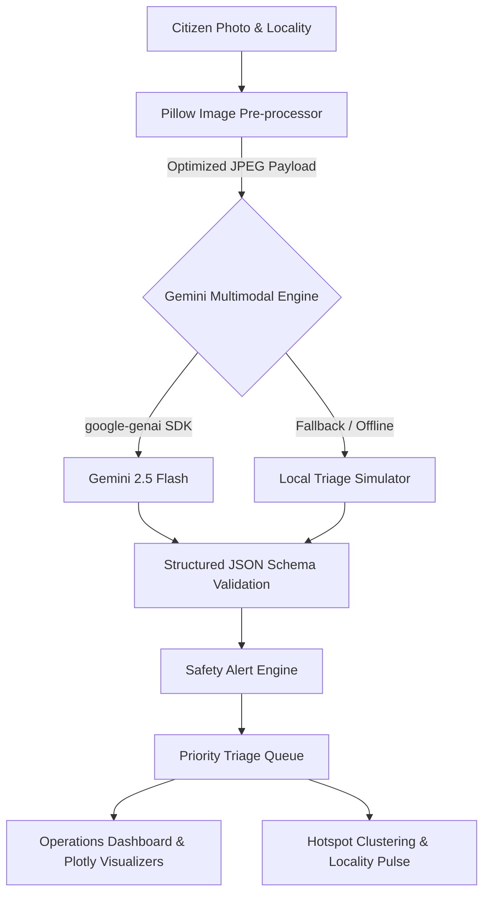

# CivicPulse AI 🛡️
> **Every Report Matters. Every Hazard Counts.**
> *AI for Better Living & Smarter Communities — Autonomous Multimodal Civic Hazard Triage*

[](https://streamlit.io/)
[](https://ai.google.dev/)
[](https://python.org)
[](#)

---

## 📌 Problem Statement
Citizen hazard reports—such as exposed electrical cables, deep arterial road craters, overflowing refuse, or ruptured municipal water mains—frequently arrive as unstructured messages with vague descriptions. 

Critical hazards (e.g., exposed high-voltage wiring after storms) get buried in the same queue as routine maintenance requests. Manual triage causes dangerous response delays, dispatch to wrong municipal departments, and leaves citizens in the dark.

## 💡 Solution & Innovation
**CivicPulse AI** is an intelligent multimodal civic intake and dispatch command center:
1. **Multimodal Visual Evidence Analysis**: Takes raw citizen photos, processes physical cues using **Google Gemini Multimodal AI**, and extracts factual visible evidence.
2. **Deterministic Schema Enforcement**: Returns structured JSON determining category, severity level, responsible municipal department, and an immediate operational action plan.
3. **Safety-First Alerting**: Instantly identifies life-threatening hazards (e.g. electrical arcing, collapsed structural covers) and advises citizens to keep clear while providing escalation guidelines.
4. **Operations Command Center & Hotspot Detection**: Visualizes real-time incident trends across wards, detects recurring municipal fault clusters, and allows dispatchers to manage statuses in an interactive priority queue.
5. **Zero-Lockout Demo Mode**: Ensures 100% demo resilience during hackathon evaluations even if API keys are missing or offline.

---

## 🚀 Key Features

| Feature | Description |
| :--- | :--- |
| **Multimodal Photo Analysis** | Analyzes uploaded images (JPG, PNG) with automatic aspect-preserving compression using Pillow. |
| **Intelligent Severity Rating** | Ranks hazards into **Critical**, **High**, **Moderate**, and **Low** with explicit rationale. |
| **Department Routing** | Automatically maps issues to Public Works, Electricity Boards, Water & Sewerage, or Sanitation. |
| **Auditability & Uncertainty Bounds** | Highlights what the model *observed* vs what *cannot be determined optically* (e.g. live voltage). |
| **Priority Operations Queue** | Dynamic, filterable triage desk sorted by criticality first with live status controls. |
| **Interactive Analytics** | Donut charts, category distribution bars, and departmental workload allocations via Plotly. |
| **Locality Hazard Clustering** | Groups incidents by citizen locality to detect recurring infrastructure hotspots. |
| **Responsible AI Standards** | Strictly adheres to decision-support boundaries without inventing fake GPS or claiming false dispatches. |

---

## 🏗️ System Architecture



---

## 🛠️ Technology Stack
- **Frontend & App Framework**: [Streamlit](https://streamlit.io/) (with custom deep navy glassmorphism CSS)
- **Multimodal AI**: [Google Gen AI Python SDK (`google-genai`)](https://github.com/googleapis/python-genai) with Gemini Multimodal Models
- **Visualization**: [Plotly Express & Graph Objects](https://plotly.com/python/)
- **Data Engineering**: [Pandas](https://pandas.pydata.org/)
- **Image Processing**: [Pillow (PIL)](https://python-pillow.org/)
- **Schema Validation**: [Pydantic v2](https://docs.pydantic.dev/)

---

## 💻 Local Installation

### Prerequisites
- Python 3.10+ (Recommended: Python 3.11, 3.12, or 3.13)
- Git

### 1. Clone the Repository
```bash
git clone https://github.com/YOUR_USERNAME/CivicPulse-AI.git
cd CivicPulse-AI
```

### 2. Create and Activate a Virtual Environment (Optional but recommended)
```bash
# Windows PowerShell
python -m venv venv
.\venv\Scripts\Activate.ps1

# Linux / macOS
python3 -m venv venv
source venv/bin/activate
```

### 3. Install Dependencies
```bash
pip install -r requirements.txt
```

### 4. Configure Gemini API Key
You can provide your Google Gemini API key in any of three ways:

#### Option A: Streamlit Secrets (Recommended)
Copy the template and edit:
```bash
# Windows PowerShell
copy .streamlit\secrets.toml.example .streamlit\secrets.toml

# Linux / macOS
cp .streamlit/secrets.toml.example .streamlit/secrets.toml
```
Open `.streamlit/secrets.toml` and set:
```toml
GEMINI_API_KEY = "AIzaSyYourActualApiKeyHere"
```

#### Option B: Environment Variable
```bash
# Windows PowerShell
$env:GEMINI_API_KEY="AIzaSyYourActualApiKeyHere"

# Linux / macOS
export GEMINI_API_KEY="AIzaSyYourActualApiKeyHere"
```

#### Option C: In-App UI Override
You can enter your API key directly in the sidebar password box at runtime.

---

## ⚡ Running the Application

Launch the Streamlit app:
```bash
streamlit run app.py
```
Open your browser to: `http://localhost:8501`

---

## 🛡️ Demo Mode (No API Key Required)
If no Gemini API key is provided, CivicPulse AI will **automatically run in DEMO MODE**:
- Clearly labeled simulated responses evaluate your input and category cues.
- Includes pre-seeded municipal reports showcasing the Operations Command Center, Priority Queue, and Hotspots immediately.
- Zero crashes, zero rate-limit blocks during live presentations.

---

## 🧪 Testing & Verification

A dedicated automated verification test suite is included in `tests/test_civicpulse.py`. Run tests using:
```bash
python tests/test_civicpulse.py
```

### Test Coverage:
1. **Module Import Verification**: Verifies `streamlit`, `pandas`, `plotly`, `PIL`, `google.genai`.
2. **Schema & Data Class Integrity**: Confirms `CivicReport` serializes correctly and adheres to category and severity constraints.
3. **Pillow Resizing**: Verifies image resizing downscales large photos while maintaining aspect ratio.
4. **Safety Filter**: Confirms immediate electrical/danger warnings fire for critical triggers.
5. **Fallback Simulation**: Validates that offline demo mode generates conforming schema objects without API keys.

---

## 🌐 Live Deployment to Streamlit Community Cloud

Deploying CivicPulse AI takes less than 3 minutes:

1. **Push to GitHub**:
   ```bash
   git init
   git add .
   git commit -m "Initial CivicPulse AI Release"
   git branch -M main
   git remote add origin https://github.com/YOUR_USERNAME/CivicPulse-AI.git
   git push -u origin main
   ```
2. **Open Streamlit Cloud**:
   - Go to [share.streamlit.io](https://share.streamlit.io) and log in with GitHub.
3. **Deploy New App**:
   - Click **New app**.
   - Select your repository: `YOUR_USERNAME/CivicPulse-AI`.
   - Branch: `main`.
   - Main file path: `app.py`.
4. **Configure Secrets**:
   - Click **Advanced settings...** -> **Secrets**.
   - Paste:
     ```toml
     GEMINI_API_KEY = "AIzaSyYourActualApiKeyHere"
     ```
   - Click **Save**.
5. **Launch**:
   - Click **Deploy!**

> **Live Demo URL:** `https://civicpulse-ai.streamlit.app` *(Placeholder - update with your deployed URL)*

---

## ⚖️ Responsible AI & Ethical Boundaries

CivicPulse AI was engineered with strict adherence to ethical and responsible civic technology practices:
- **Decision Support, Not Final Determination**: All AI outputs assist human operators; they do not replace qualified municipal engineers or building inspectors.
- **No Fictitious Dispatches**: The app never pretends to dispatch emergency crews or emergency vehicles without verified API integration.
- **Optical Uncertainty Transparency**: Each report lists technical uncertainties—stating clearly that things like *live electrical voltage* or *underground pipe pressure* cannot be confirmed by camera alone.
- **Privacy & Location Ethics**: The platform does not attempt to extrapolate private personal data or pinpoint exact residential boundaries from photos.

---

## 🔮 Future Enhancements
- [ ] Integration with municipal Open311 APIs for automated dispatch synchronization.
- [ ] Multilingual speech-to-text intake for non-English speaking citizens.
- [ ] Satellite & GIS layer overlay with open street map (OSM) ward geometries.
- [ ] Duplicate incident clustering using vector embeddings across nearby coordinates.

---

## 📄 License
Released under the [MIT License](LICENSE). Built for the **AI for Better Living & Smarter Communities** Hackathon.
